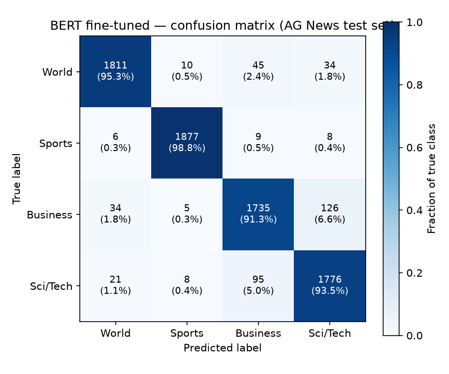
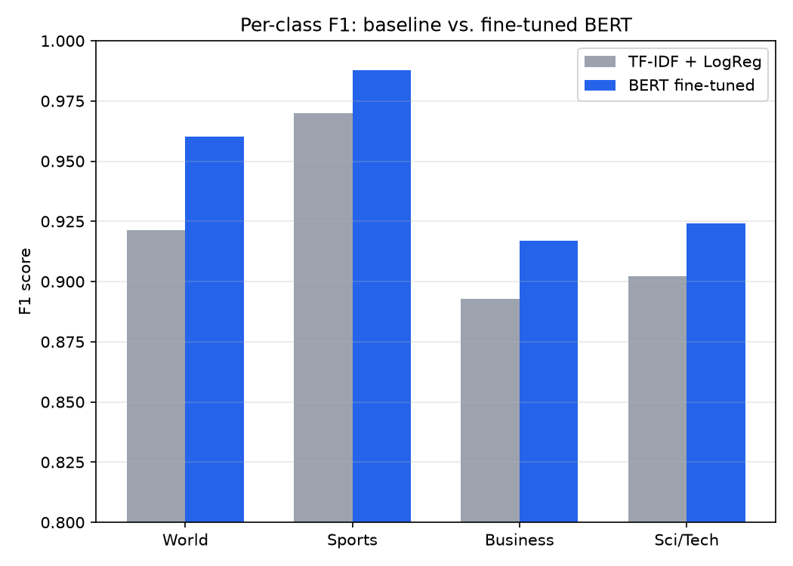

# BERT News Classification

Fine-tunes `bert-base-uncased` on the **AG News** dataset (4-class topic
classification: World / Sports / Business / Sci-Tech) and compares it
against a TF-IDF + Logistic Regression baseline. Includes a live Gradio
demo for interactive classification.

## Results (AG News test set, 7,600 held-out examples)

| Model                        | Accuracy | Macro F1 |
|-------------------------------|----------|----------|
| TF-IDF + Logistic Regression  | 92.17%   | 92.15%   |
| **BERT (fine-tuned, 2 epochs)** | **94.72%** | **94.73%** |

BERT improves over the baseline by **+2.55 points accuracy**, with the
largest gains on Business and Sci/Tech — the two classes that overlap most
in vocabulary and are hardest to separate with bag-of-words features.




Full numbers (per-class precision/recall/F1, confusion matrix) are in
[`reports/bert_results.json`](reports/bert_results.json) and
[`reports/baseline_results.json`](reports/baseline_results.json).

## Training setup

- Base model: `bert-base-uncased`
- Dataset: `fancyzhx/ag_news` — 120,000 train / 7,600 test examples
- Max sequence length: 128 tokens
- 2 epochs, batch size 16, LR 2e-5, cosine schedule with warmup,
  early stopping on eval loss (patience 1)
- Trained on Apple Silicon (MPS backend); ~5h20m wall-clock for the full run
- Full `TrainingArguments` in [`src/train.py`](src/train.py)

## Project layout

```
src/
  data_pipeline.py   - loads + tokenizes AG News
  baseline.py         - TF-IDF + LogisticRegression baseline
  train.py             - HF Trainer fine-tuning script
  make_figures.py     - generates reports/figures/*.png from results JSONs
  app.py               - Gradio demo for interactive classification
reports/
  bert_results.json       - BERT metrics (accuracy, F1, confusion matrix)
  baseline_results.json   - baseline metrics
  figures/                 - confusion matrix + F1 comparison charts
models/                    - fine-tuned weights (gitignored, ~400MB — regenerate via train.py)
```

## Running it

```bash
python3 -m venv venv && source venv/bin/activate
pip install -r requirements.txt

cd src
python3 baseline.py          # TF-IDF + LogReg baseline
python3 train.py              # fine-tune BERT (long-running; MPS/CUDA/CPU auto-detected)
python3 make_figures.py      # regenerate the figures above
python3 app.py                 # launch the Gradio demo at http://127.0.0.1:7860
```

## Verified

- Baseline and BERT both trained and evaluated end-to-end on the real AG
  News test set — the numbers above are measured, not projected.
- `app.py`'s classifier loads the saved fine-tuned weights and was smoke
  tested directly against sample headlines (correctly predicting Sports and
  Business with >98% confidence).
